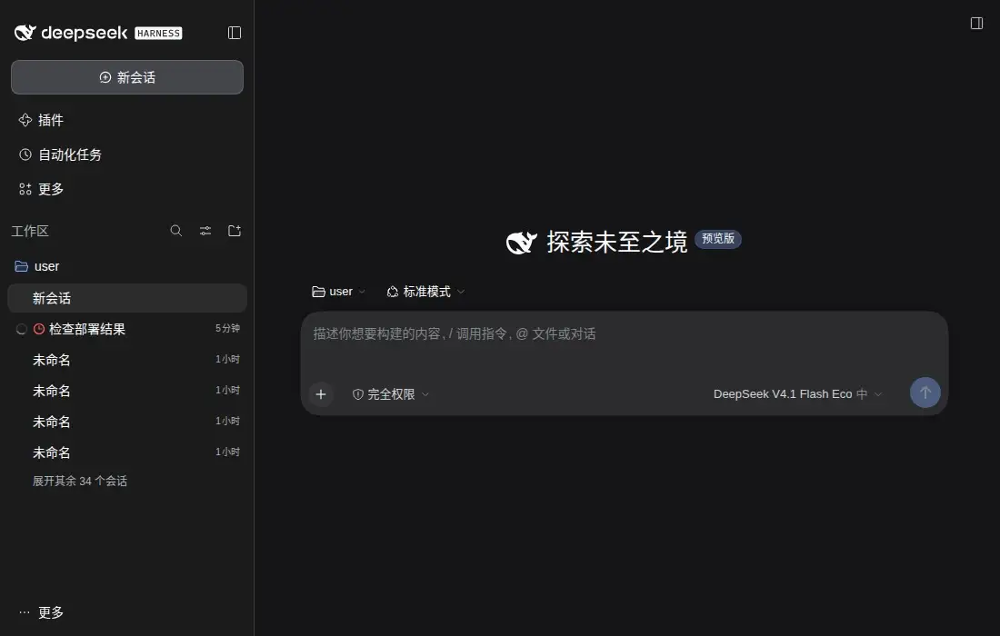
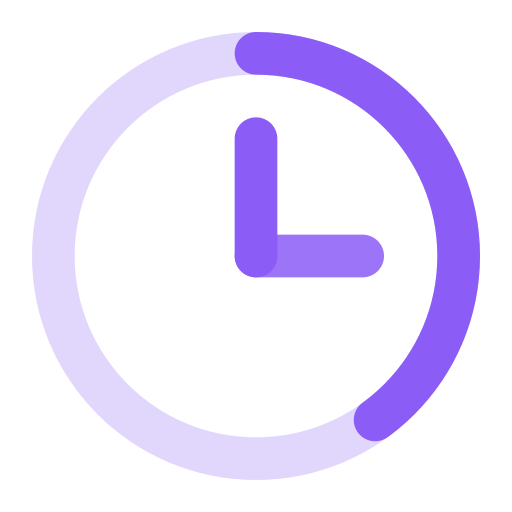
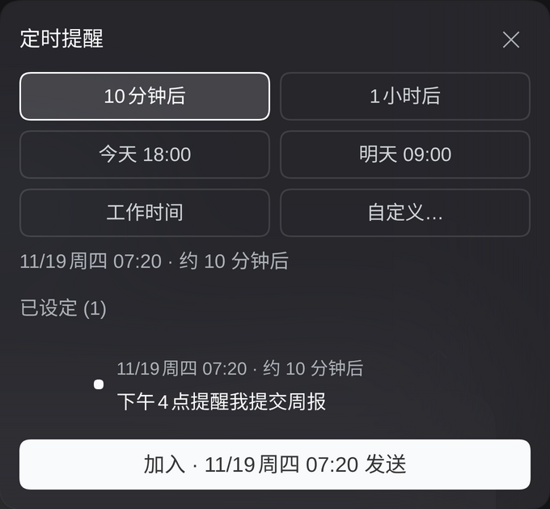
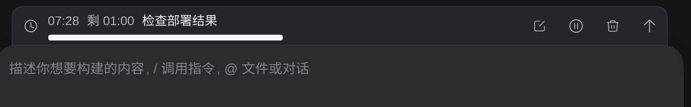
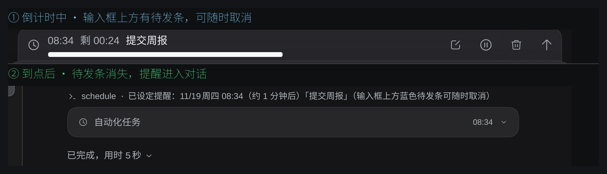
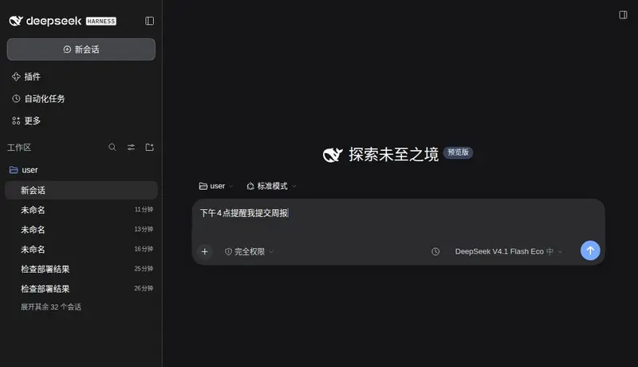
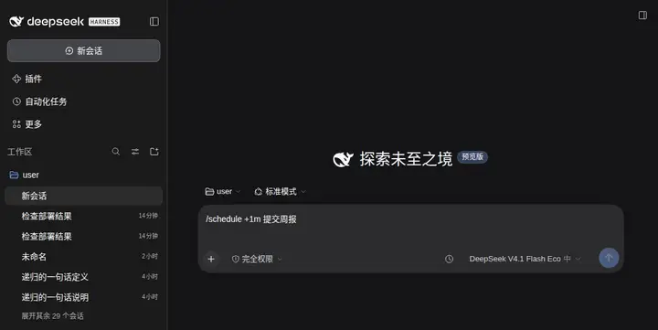

<div align="center">


# dsh-later — In-Session Scheduled Message Plugin

[中文](./README.md) | **English**

</div>

> Set reminders for yourself inside DSH: **set by you, delivered into the current conversation, driven server-side, available across devices** — on time, even with the browser closed.

**`/later` delayed send** — no panel needed: type one line in the input box and it is sent later as yourself (demo: typing `/later +5s`, `+3m`, `+1h20m` character by character, then Enter to start the countdowns; the `+5s` one really lands when due):

<p align="center">

</p>

---

## How to use

### Schedule panel

Click the **"Schedule send"** button to the right of the input box. The panel uses the **input box content** as the reminder text; pick a time, then click **"Add · send at HH:MM"** (the button stays disabled until a time is chosen). A countdown row then appears above the input box.

| Capability | Description |
|---|---|
| Quick chips | One-tap `in 10 minutes` / `in 1 hour` / `work hours` (configurable in settings) |
| Custom time | "Custom…" opens date + time inputs |
| Task list | This conversation's scheduled items, deletable one by one |

Pause, resume, text editing and send-now are not in the panel: they are per-row actions in the [pending dock](#pending-dock).

### Time formats

All of these are accepted (`/schedule`, `/later`, and the panel's custom time share the same parser; the rows marked *commands only* are rejected by the panel):

| Kind | Examples |
|---|---|
| Relative duration | `+30m` · `+1h30m` · `+90s` · `+1w` · `30分钟后` · `半小时后` · `in 30 minutes` · `in 30 Minuten` · `dans 30 minutes` · `en 30 minutos` · `через 30 минут` · `em 30 minutos` |
| Time today | `15:32` · `9点` · `9点半` · `1532` |
| Relative day + time | `明天9点` · `明日9時` · `tomorrow 9am` · `morgen 9 Uhr` · `demain 9:00` · `mañana 9:00` · `завтра 9:00` · `amanhã 9:00` |
| Date + time | `8月21日 15:32` · `2026-08-21 15:32` · `0821-1532` |
| Repeat, fixed interval (*commands only*) | `+1h*3 drink water` · `+30m×2 check build` |
| Repeat, chained sequence (*commands only*) | `+1h+1h+0.5h watch the rollout` · `+1h +30m submit report` |
| Anchor sequence (*commands only*) | `15:32+16:32+17:32 three meetings` · `9:00+1d+1d standup` · `明天9点+1h` |

The three bolded rows above are **[Advanced syntax (Beta)](#configuration)** and can be switched off together in settings; every other form is unaffected.

A bare time (like `1532`) rolls over to tomorrow if it has already passed today (up to 7 days). Writing `明天`/`后天` is taken literally — if that time has passed you are told to use a concrete date instead. A month/day only (like `8月21日`) rolls over to next year when this year's has passed.

Multi-shot rules — **the first occurrence lands after the first interval**:

| Input | Expands to |
|---|---|
| `+1h*3` | t+1h, t+2h, t+3h |
| `+1h+1h+0.5h` | t+1h, t+2h, t+2.5h (chained — good for "2 h → 1 h → 30 min before the deadline" nagging) |
| `15:32+16:32+17:32` | those three clock times today |
| `23:00+01:00` | 23:00 today, **tomorrow** 01:00 (an earlier time in the chain rolls over, same rule as a single shot) |
| `9:00+1d+1d` | 09:00 on three consecutive days |

At most **10 tasks** per command, and multi-shot intervals must be **≥ 60 seconds** (single shots are unrestricted — `/later +5s` still works). `*`, `×` and `x` all work, an optional Chinese counter suffix is accepted (`*3次`), and the count must be followed by a space. Every occurrence is an **independent task**: cancel it, edit it or send it early on its own, and `/later` attachments are carried by each one. Absolute times (`15:32`, `明天9点`) do **not** accept `*count` — you get an explicit error instead of a silently wrong single task.

Chains allow exactly **one direction: an absolute anchor, then forward accumulation.** `+1h+15:32` (a clock time after a duration) is rejected rather than guessed.

Anchor chains are stored as `at` (wall clock) and relative chains as `after` (elapsed seconds); which of the two can be paused is covered in [Pending dock](#pending-dock).
An anchor keeps the wall clock across DST (`9:00+1d` stays 09:00) while a relative chain counts real seconds.

### Commands

| Command | Effect |
|---|---|
| `/schedule <time> <content>` | Create a reminder (shows up in the conversation when due) |
| `/later <time> <content>` | Delayed send: deliver the content later as yourself |
| `/later <time>*<count> <content>` | Same, expanded into N delayed sends (`+1h*3`) |
| `/schedule <time>+<time> <content>` | Same, a chained sequence expanded into N reminders (`+1h+30m`) |
| `/later <clock>+<clock> <content>` | Anchor sequence: expand by wall-clock instants (`15:32+16:32`, `9:00+1d+1d`) |

```
/schedule 明天9点 提交周报
/later 1532 提醒团队同步进度
/later +1h*3 起来喝水
/later +2h+1h+30m 催我交周报
```

The dock buttons just run the `/user-schedule-*` commands, so you can type them too (payload is JSON).
Typing takes two presses of Enter: the first claims the line as a command, the second runs it.

### Images and files

`/later` carries attachments: paste an image or drop a file into the composer, then type `/later +10m take a look at this` and hit enter. When it fires, the content goes out **with the attachments**, under your identity — the message has exactly the same shape as a "text + image" message you send by hand.

- **Only `/later` carries them.** `/schedule`, the panel, and model-created tool schedules never do — a deliberate trust boundary: attachment blocks may only enter a sent-as-user message through the channel where you typed the command yourself, so an `attachments` field smuggled into tool arguments has no effect.
- Multi-shot syntax (`+1h*3`) attaches **the same** files to each expanded task; each row is still independently cancellable, editable and sendable.
- The dock row shows a **real thumbnail**; if this host does not persist attachments, it degrades into an "available after send + size" marker. That does **not** mean the attachment was lost.
- Each task renders at most 8 thumbnails in the dock, with `+N` for the rest; non-image attachments become a "file name + size" chip.
- Non-image attachments degrade on older kernels; see the degradation table under [Supported DSH kernels](#supported-dsh-kernels).

The model can create, list and delete reminders for you (`user_schedule_create` / `_list` / `_delete`) and can create **open-ended recurring** tasks ("remind me every hour"). Editing, pausing, resuming and sending now are not exposed to the model; those are dock buttons you press yourself. A bundled `SKILL.md` (skill `later-reminders`) also stays in the model's skill catalog and covers *when* to schedule proactively; it is absent when the host assembly has no skills service, and everything else works.

### Pending dock

The countdown rows above the input box. Each row ends with four buttons: **Edit reminder** (change the text inline), **Pause / resume reminder**, **Delete reminder** (cancel that item), and **Send now** (push it to the agent immediately, skipping the countdown; periodic `every` rows have no Send now button).

Pause is only open to "wait N more minutes" (`after`) reminders that have not fired yet: clock-time `at` rows and recurring `every` rows grey the button out and say why on hover, and a row that already fired can only be deleted or sent. While paused the countdown and the progress bar freeze and the attachments stay on the item; resuming re-arms the **remaining** time from the moment you resume, so the fire time moves later by however long it was paused.

> ⚠️ "Send now" is not a confirm button — it **immediately** delivers the reminder text to the agent and wakes the model. To cancel, use Delete.

### Sidebar presence indicator

Conversations with active reminders show a clock in their sidebar row (alongside the "active" orb). Two styles switch with the kernel generation and can also be pinned in settings:

| Meaning | Classic (pixel grid) | Modern (stroke + progress arc) |
|---|---|---|
| Purple · has scheduled reminders |  |  |
| Amber · next fire within 5 minutes |  |  |
| Red · overdue (waiting for the session to become idle) |  |  |

The bright outer arc in the modern style is the **fraction of the wait already elapsed**, filling in as the countdown runs: almost empty when just scheduled, a full ring at due time. When progress cannot be computed (a paused item, for example) the arc is not drawn and only the base ring remains.

With the "clock icon style" set to `auto` (the default) the style follows the kernel generation: `0.2.0` and above use the modern one, `0.1.x` the classic one. It can also be pinned to `modern` or `classic`.

Hover shows "Next at 15:32 · 3 task(s)"; when overdue it shows "Due · 3 task(s) (sends when the session is idle)". When every reminder in the conversation is paused the icon stays purple and hover reads "Paused · 3 task(s)", because a paused item has no scheduled time to report.

The sidebar hover card gains one status line ("3 scheduled reminder(s), next 15:32"), shaped like the host's own status rows and **appended** to them: the existing rows and their ordering are untouched, and overdue and paused each have their own wording.

---

## Screenshots

**Schedule panel** — quick slots / custom time / pending list:



**Pending dock** — countdown rows above the input box (inline edit / pause / delete / send now):



**A real due-time firing** — top: counting down with the pending bar above the input box; bottom: once due, the bar is gone and the reminder has entered the conversation (it fires even with the page closed):



**Animated demos**:

| Creating a reminder (type → panel → add → dock) | Firing when due (countdown → message arrives) |
|---|---|
|  |  |

---

## Feature overview

- **Fires with the page closed — both levels hold now**:
  - **Browser closed, server running**: reminders live server-side and arrive on time across devices.
  - **Server restarted, that session was never opened**: true now, but needs **plugin 1.12.1 or newer**. 1.12.0 carried a "wakes the session but never drives delivery" defect, so those reminders stayed silent at due time.

  Bounds and backoff are in [`docs/verification.md`](./docs/verification.md) under "remaining bounds": the host must be able to rebuild the session (when neither path works the reminder is marked `undelivered` and reported, without retrying forever); delegated child sessions are not cold-woken; a cold wake costs one turn; a just-closed session has a 120s grace period.

- **Never impersonates you**: when due, the message appears as a `Reminder` — it is never framed as your own words.
- **Multilingual**: UI copy follows the DSH UI language across **8 locales** (中文 / English / 日本語 / Español / Français / Deutsch / Русский / Português), live without reload.
  
  > ⚠️ **Six** of them (ja / es / fr / de / ru / pt) are machine-translated and only passed mechanical checks (placeholders preserved verbatim, proper nouns untranslated, no zero-width characters) — **not reviewed by native speakers**. Please open an issue for bad translations.
- **Reminders don't carry across sessions**: sessions forked from this one never inherit the parent's reminders.

---

## Reminders vs. delayed sends: what's the difference?

| Action | When it takes effect | Who sends it | What you see |
|---|---|---|---|
| Enter in the input box | Immediately | You | Normal user bubble |
| Schedule panel / `/schedule <time> <content>` | When due | The reminder | `Reminder · HH:MM · content` row |
| `/later <time> <content>` | When due | As yourself | Normal user bubble |

> **`/schedule` is not "delayed send"**: pressing Enter on `/schedule …` sends it *immediately* (as a user message); only the **reminder itself** is deferred. If you want "send the text I'm typing now, later, as if I said it", use **`/later`**.

---

## Quick start

### Supported DSH kernels

| Kernel generation | Status | Install handle |
|---|---|---|
| `0.1.2-rc.1` | Supported | — |
| `0.1.5-rc.3` | Supported | — |
| `0.1.7-rc.1` / `0.1.7-rc.2` | Supported | — |
| `0.2.0-rc.2` / `0.2.1-rc.2` | Supported | — |
| `0.2.1-rc.3` / `0.2.1-rc.4` | Supported | — |
| `0.2.2-alpha.2` | Supported | — |
| `0.2.2-alpha.3` | Supported (`dsh-schedule` switched models; adapted) | — |
| `0.2.2-rc.1` | Supported | — |
| `0.2.2-rc.2` | Supported (one breaking change each in primitives / registry; adapted) | — |
| `0.2.2-rc.3` | Supported (the `next` track of the kernel's three-track release; no new breaking change) | `dsh-later@dsh-0-2-2-rc-3` |
| `0.2.2-rc.4` | Supported (`next` advanced to rc.4; zero runtime diff vs rc.3, covered via the `@next` channel) | — |

**Install channel** (follows the kernel's dist-tag):

| Your kernel track | Install |
|---|---|
| `latest` (stable) | `npm i dsh-later@latest` (same as no tag) |
| `next` (release candidate) | `npm i dsh-later@next` |
| `alpha` (early development) | `npm i dsh-later@alpha` |

Channel tags are derived by `npm run sync:tags` from the kernel's live dist-tags: it looks up which generation the channel points at, then picks the **highest plugin version verified on that generation**. **An unverified channel is reported as undecided and the command exits non-zero; it never falls back to `latest`**.

**Install handle**: a dist-tag pinned to one kernel generation, e.g. `npm i dsh-later@dsh-0-2-2-rc-3` gives the release verified on `0.2.2-rc.3`.

The declaration lives in `package.json` under `engines.dsh`: `>=0.1.2-rc.1 <0.1.3-0 || >=0.1.5-rc.3 <0.1.6-0 || >=0.1.7-rc.1 <0.1.8-0 || >=0.2.0-rc.2 <0.2.1-0 || >=0.2.1-rc.2 <0.2.2-0 || >=0.2.2-alpha.2 <0.2.3-0`. Node `^22.19 || >=24`.

Two boundaries:

- **`0.1.1-rc.2` is not supported.** Its dependency line cannot be installed at all (`@deepseek-ai/dsh-util-workspace-path@0.1.1-rc.2` was never published), so no tool can produce a verdict.
- **`0.1.5` is verified as `rc.3`, not `rc.1`.** `dsh@0.1.5-rc.1` depends on `^0.1.5-rc.1`, so a default install resolves the whole plugin line to `rc.3`. **What you actually get is a uniform `rc.3`**, so that is the only shape we verify.

Old kernels come with four visible degradations. Nothing is lost, but the looks and the wording change.

| Kernel | What you see |
|---|---|
| `0.1.2` | Non-image attachments arrive as a `[附件] <file name>` text block (that generation's `ContentBlock` has no `file` variant); image blocks are unaffected |
| `0.1.2` | Attachment icons are always a paperclip, and the size text is computed locally (base 1024, one decimal), not guaranteed to match the host's wording character for character |
| `0.1.5` and older | A long tooltip can be clipped by a scrollable ancestor (that Tooltip does not escape the flow) |
| `0.1.5` line | Settings get written into the profile config; the affected fields are boolean switches, harmless |

### Install into DSH

**From npm (recommended — prebuilt, no approval needed):**

```sh
dsh plugin --profile web add dsh-later
# restart dsh web to activate
```

Or build from source and add it to your DSH Web profile:

```sh
cd dsh-later
pnpm install                # the repo is a pnpm workspace (pnpm-lock.yaml + pnpm-workspace.yaml)
pnpm run build

dsh plugin --profile web add "file:/path/to/dsh-later"
# restart dsh web to activate
```

> Source-level tinkerers: see [`AGENTS.md`](./AGENTS.md) and the `package.json` scripts;
> changes are not synced to the GUI copy automatically, run `npm run deploy`.

## Long-text reminders

Reminder content is limited to **1000 characters** by default. For longer content, enable `allowLongPrompts` and set `maxPromptChars` (both rows are in the [Configuration](#configuration) table).

- **Good for**: code snippets, meeting notes, long quotes, cross-device notes/todos.
- **Not recommended**: text that could read as instructions (the longer it is, the bigger the risk); a shared public profile (anyone could raise the limit).

---

## Configuration

Works out of the box. Adjust in **DSH Settings → Plugins → Session Scheduler** (applies live, no restart):

| Field | Description | Default |
|---|---|---|
| Show schedule button | Whether the timer button shows on the input bar (hiding it never affects existing reminders or the dock) | Shown |
| Show scheduled in group badge | Whether the "Scheduled" cell appears on the folded-group badge of dsh-group-status; off = **we do not register the facet**, reminders still fire | Shown |
| Max schedules per session | Max reminders allowed in one conversation | 100 |
| Allow long prompts | Lift the 1000-character default cap | Off |
| Custom cap | Character cap when `allowLongPrompts` is on | 1000 |
| Work hours / lunch / night quiet | Five HH:mm fields driving smart slots and auto-scheduling | See settings page |
| Interjection delivery | Which queue "Send interjection" uses: own turn (default, safe) / current turn (faster, can drop in an edge case) | Own turn |
| Delivery confirmation / on unconfirmed | Whether to verify a reminder really landed, and what to do when it isn't confirmed | On / keep |
| Clock icon style | `auto` (by kernel version) / `modern` / `classic` | auto |
| Scheduled message marker | Clock marker on bubbles delivered by `/later`: `left` always beside the bubble / `meta` a small line above / `hover` only on hover / `off` leaves rendering to the host. **Only effective on kernel 0.2.1+** | left |
| **Advanced syntax** (Beta) | Master switch for multi-shot forms: `+1h*3`, `+1h+1h+0.5h`, `15:32+16:32`, `9:00+1d`. When off, those forms are rejected with a pointer back to settings | **On** |

> Advanced syntax is marked Beta because **the resulting presentation still needs watching**. The grammar itself is covered case by case; see [docs/verification.md](./docs/verification.md).

---

## For plugin developers

Two contracts are exposed; full detail lives in [docs/technical/03-api-reference.md](./docs/technical/03-api-reference.md):

- **Schedule summary API (`dsh-later/client`, cross-plugin)**: `getScheduleSummaryStore()` / `summarizeScheduleGroup()` /
  `useScheduleSummary()`. Other client plugins (e.g. dsh-group-status) aggregate schedule state from it instead of
  parsing the `userSchedules` projection themselves, and cannot drift from the inline row badge. Consumers must
  tolerate `undefined` (plugin not loaded) and degrade silently.
- **Folded-group badge facet (`dsh-later.schedule`)**: registered per
  [facet protocol v1](https://github.com/dsh-plugin-collection/dsh-group-status/blob/main/docs/facet-protocol.md);
  counting basis, tone, pulse, wording and glyph are all decided here. dsh-group-status is an **optional partner**:
  when absent we skip registration and everything else keeps working. Visibility is the `showInGroupBadge`
  switch here (off means no registration, so the partner no longer needs a switch of its own).

## Technical documentation

**The full index is [`docs/README.md`](./docs/README.md)**. The most-used entries:

- [Architecture and data flow](./docs/architecture.md)
- [Key design decisions](./docs/design-decisions.md)
- [Verification status](./docs/verification.md)
- [UI cross-generation screenshot matrix](./docs/notes/ui-matrix.md)
- [Plugin API reference](./docs/technical/03-api-reference.md)

## License

MIT

---

<div align="center">


</div>
