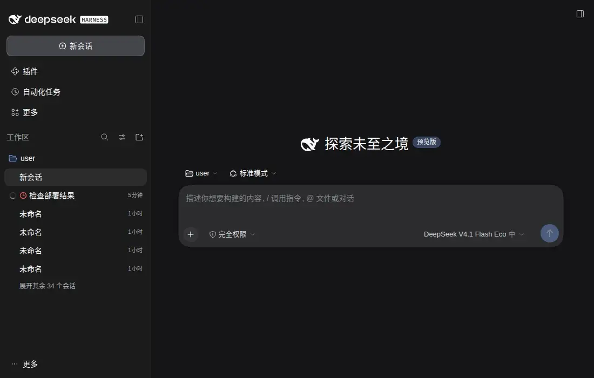
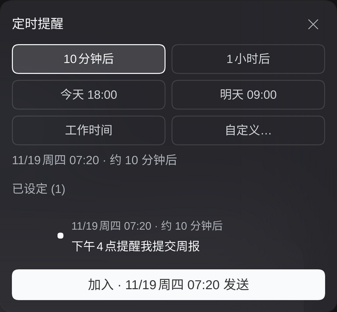
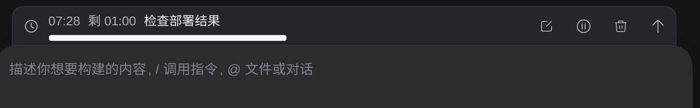
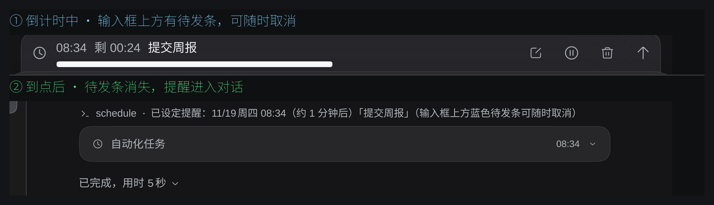
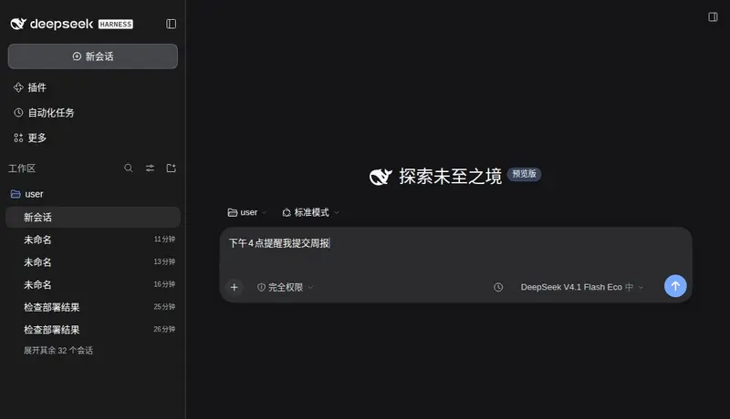
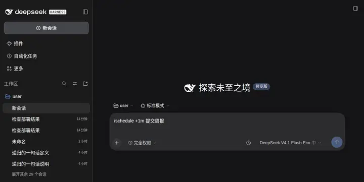

<div align="center">


# dsh-later — 会话内定时消息插件

**中文** | [English](./README.en.md)

</div>

> 在 DSH 里给自己设提醒：**用户自己设、当前对话收到、服务端驱动、跨设备**——到点准时送达，即使你关掉了网页。

**`/later` 延迟发送** —— 不开面板，在输入框敲一行就以你的身份稍后发出（演示：逐字输入 `/later +5s` / `+3m` / `+1h20m`，回车后进入倒计时；`+5s` 那条到点真实送达）：

<p align="center">

</p>

---

## 使用方法

### 定时面板

点输入框右侧的 **「定时发送」** 打开面板。面板以**输入框内容**作为提醒内容，选好时间后点 **「加入 · HH:MM 发送」**（未选时间时该按钮不可点）即可；输入框上方随即出现倒计时条。

| 能力 | 说明 |
|---|---|
| 快捷芯片 | `10分钟后` / `1小时后` / `工作时间` 一键填充（智能时段可在设置里改） |
| 自定义时间 | 「自定义…」展开日期 + 时间输入框 |
| 任务列表 | 本会话已设定的任务，可逐条删除 |

暂停、恢复、改内容、立即发送都不在面板里，在 [待发送 dock](#待发送-dock) 上逐条操作。

### 时间格式

以下写法都认（`/schedule`、`/later` 与面板自定义时间共用；标了「仅 `/later` `/schedule`」的写法面板不收）：

| 类型 | 示例 |
|---|---|
| 相对时长 | `+30m` · `+1h30m` · `+90s` · `+1w` · `30分钟后` · `半小时后` · `in 30 minutes` · `in 30 Minuten` · `dans 30 minutes` · `en 30 minutos` · `через 30 минут` · `em 30 minutos` |
| 当天时刻 | `15:32` · `9点` · `9点半` · `1532` |
| 相对日 + 时刻 | `明天9点` · `明日9時` · `tomorrow 9am` · `morgen 9 Uhr` · `demain 9:00` · `mañana 9:00` · `завтра 9:00` · `amanhã 9:00` |
| 日期 + 时刻 | `8月21日 15:32` · `2026-08-21 15:32` · `0821-1532` |
| **重复 · 等间隔**（仅 `/later` `/schedule`） | `+1h*3 喝水` · `+30m×2 看构建` · `两小时后×3次` |
| **重复 · 链式序列**（仅 `/later` `/schedule`） | `+1h+1h+0.5h 盯发布` · `+1h +30m 交周报` |
| **锚点序列**（仅 `/later` `/schedule`） | `15:32+16:32+17:32 三会` · `9:00+1d+1d 打卡` · `明天9点+1h` |

上表三行加粗的都属于 **[高级语法（实验性）](#配置)**，可在设置里一键关闭；其余写法不受开关影响。

只写时刻（如 `1532`）时，若今天已过会自动顺延到明天（最多 7 天）；写了 `明天`/`后天` 则按字面理解，该时刻已过会提示改用具体日期；只写月日（如 `8月21日`）时，今年已过则顺延到明年。

多次写法的规则（**首次落在第一个间隔之后**）：

| 写法 | 展开成 |
|---|---|
| `+1h*3` | t+1h、t+2h、t+3h |
| `+1h+1h+0.5h` | t+1h、t+2h、t+2.5h（链式累加，用来写「提前 2h→1h→30m」这类梯度催办） |
| `15:32+16:32+17:32` | 今天 15:32、16:32、17:32（三个挂钟时刻） |
| `23:00+01:00` | 今天 23:00、**次日** 01:00（后一个时刻更早则自动顺延，规则同单条） |
| `9:00+1d+1d` | 连续三天都是 9:00 |

一次最多 **10 条**，多次写法的间隔不低于 **60 秒**（单条不受此限，`/later +5s` 照旧）。`*` `×` `x` 都认，可跟中文量词（`*3次`），次数后面要留空格。每条都是**独立任务**：可单独取消、编辑、插话发送（暂停见下表）。

序列里只允许**「绝对时刻开头，往后累加」**这一个方向：`+1h+15:32` 会明确报错，不会猜。

锚点序列落库为 `at`（按挂钟时刻），相对序列落库为 `after`（按秒数）；两类能否暂停的差别见[待发送 dock](#待发送-dock)。
跨夏令时时锚点保持墙钟不变（`9:00+1d` 永远是 9:00），相对序列按真实秒数累加。

### 命令

| 命令 | 作用 |
|---|---|
| `/schedule <时间> <内容>` | 创建一条定时提醒（到点出现在对话里） |
| `/later <时间> <内容>` | 延迟发送：到点以你的身份发出该内容 |
| `/later <时间>*<次数> <内容>` | 同上，展开成 N 条代发（`+1h*3`） |
| `/schedule <时间>+<时间> <内容>` | 同上，链式序列展开成 N 条提醒（`+1h+30m`） |
| `/later <时刻>+<时刻> <内容>` | 锚点序列：按挂钟时刻展开（`15:32+16:32`、`9:00+1d+1d`） |

```
/schedule 明天9点 提交周报
/later 1532 提醒团队同步进度
/later +1h*3 起来喝水
/later +2h+1h+30m 催我交周报
```

dock 上的按钮就是 `/user-schedule-*` 那几条命令，手敲也能用（参数是 JSON）。
手敲要按两次回车：第一次认领整行为命令，第二次才执行——这是内核带参命令的统一顺序。

### 带图片 / 文件

`/later` 可以带附件：先在输入框贴图或拖文件，再敲 `/later +10m 看下这张图` 回车。到点会**连同附件**以你的身份发出，消息形状和你手动发「文字 + 图」完全一致。

- **只有 `/later` 带附件**。`/schedule`、面板、以及模型调用工具创建的提醒都不带——这是一条安全边界：附件块只能经「你亲手输入」这条可信通道进入代发内容，模型在工具参数里夹带 `attachments` 一律无效。
- 多次写法（`+1h*3`）把**同一份**附件逐条带到每条任务上，各条仍可单独取消/编辑/插话。
- dock 行显示**真缩略图**；若这台宿主的附件后端不落盘，退化成「发送后可见 + 大小」的标记，那**不代表附件丢了**，到点照样随消息发出。
- 每条任务在 dock 上最多渲染 8 个缩略图，超出显示 `+N`；非图片附件显示成「文件名 + 大小」的 chip。
- 老内核上非图片附件退成 `[附件] 文件名` 文本，原因与范围见[支持的 DSH 内核](#支持的-dsh-内核)末尾的降级表。

模型能替你建 / 查 / 删提醒（`user_schedule_create` / `_list` / `_delete`），也能建**无限周期**任务（「每小时提醒我喝水」）。改内容、暂停、恢复、立即发送不暴露给模型，只在 dock 上由你亲手操作。随包还有一份 `SKILL.md`（技能名 `later-reminders`）常驻模型的 skill catalog，管「什么时候该主动排」；宿主装配里没有 skills 服务时它就不出现，其余功能照常。

### 待发送 dock

输入框上方的倒计时条，每行行尾四个按钮：**编辑提醒**（就地改内容）、**暂停 / 恢复提醒**、**删除提醒**（取消该条）、**插话发送**（立即推给 agent，不等倒计时；周期任务那一行没有这个按钮）。

暂停只对「再等 N 分钟」这一类（`after`）且还没到点的提醒开放：按挂钟时刻排的 `at` 与周期 `every` 会把按钮置灰，悬停说明原因（已到点的也只能删或发，不能再暂停）。暂停时倒计时与进度条冻结、附件留在条目上；恢复后按**剩余时长**从恢复那一刻重新排期，触发时刻随之顺延。

> ⚠️ 「插话发送」不是「确认」，点了会**马上**把提醒内容发给 agent 并唤醒模型；只想取消请点删除。

### 侧栏状态标识

有活动提醒的会话，行内会出现一个时钟标识（与「进行中」orb 并存）。两种风格随内核代次自动切换，也可在设置里锁定：

| 含义 | 经典（像素点阵） | 新版（描边 + 进度弧） |
|---|---|---|
| 紫 · 有定时中提醒 |  |  |
| 琥珀 · 下次触发 ≤ 5 分钟 |  |  |
| 红 · 已到期（等待会话空闲派发） |  |  |

新版外圈那道亮弧是**已过时长占比**，随着倒计时一点点填满：刚排上时几乎是空的，到点时绕成一整环。无从计算进度时（例如暂停中的条目）那道弧不画，只剩底环。

「时钟图标风格」设 `auto`（默认）时按内核代次选：`0.2.0` 及以上用新版，`0.1.x` 用经典；也可以显式锁定 `modern` / `classic`。

鼠标悬停可见「下次 15:32 · 3 条任务」；已到期时显示「已到期 · 3 条任务（等待会话空闲发送）」；全部提醒都暂停时图标仍是紫色，悬停显示「已暂停 · 3 条任务」（暂停项没有排定时刻，所以不报「下次」）。

侧栏行的悬浮卡片里会**追加**一行状态（「有 3 条定时提醒，下次 15:32」），与宿主自己的 `空闲` / `进行中` 同构、不改写它们；已到期与已暂停各有一句对应文案。

---

## 界面展示

**定时面板** —— 快捷时段 / 自定义时间 / 已设定任务列表：



**待发送 dock** —— 输入框上方倒计时条（行内编辑 / 暂停 / 删除 / 插话；下方即输入框）：



**到期真实触发** —— 上：倒计时中，输入框上方有待发条；下：到点后待发条消失，提醒进入对话（关网页也照常触发）：



**动图演示**：

| 创建定时提醒（输入 → 面板 → 加入 → dock） | 到期触发（倒计时 → 收到消息） |
|---|---|
|  |  |

---

## 特性一览

- **关网页也能触发，两档都成立**：
  - **浏览器关掉、服务端在跑**：提醒存在服务端，关网页、换设备都会准时到达。
  - **服务端重启、那条会话从没被打开过**：成立，但需要 **1.12.1 及以上的插件版本**。1.12.0 带着「唤醒会话却不驱动投递」的缺陷，那些提醒到点不会响。

  边界与退避策略见 [`docs/verification.md`](./docs/verification.md) 的「剩余边界」：宿主得能重建会话（两条路都不通时记 `undelivered` 并告警，不反复重试）；被委托的子会话不冷唤醒；冷唤醒会占用一个 turn；刚关掉的会话有 120s 宽限。

- **不会冒充你本人**：到点后显示为「定时提醒」消息，而不是假装是你自己发的。
- **多语言**：界面文案跟随 DSH 界面语言，覆盖全部 **8 门**（中文 / English / 日本語 / Español / Français / Deutsch / Русский / Português），切换即时生效。
  
  > ⚠️ 其中 **6 门**（ja / es / fr / de / ru / pt）由机器翻译产出，只做过「占位符逐字保留、专有名词不译、无零宽字符」三项机械校验，**未经母语者审校**。发现译法问题请开 issue。
- **提醒不跨会话**：由当前会话派生出的子会话，不会带上父会话的提醒。

---

## 定时提醒和延迟发送，有什么区别？

| 动作 | 什么时候生效 | 谁发出 | 你看到 |
|---|---|---|---|
| 输入框 Enter 直接发 | 立即 | 你 | 普通用户气泡 |
| 定时面板 / `/schedule <时间> <内容>` | 到点 | 定时提醒 | `定时提醒 · HH:MM · 内容` 提醒行 |
| `/later <时间> <内容>` | 到点 | 以你的身份 | 普通用户气泡（可开「定时消息标记」） |

> **`/schedule` 不是「延迟发送」**：输入框里那行 `/schedule …` 一按回车就会**立刻**发出去（作为一条用户消息），被推迟的只是**提醒本身**。如果你想要的是「把我现在打的这句话，过会儿当作我亲口发的」，请用 **`/later`**。

---

## 快速开始

### 支持的 DSH 内核

| 内核代次 | 状态 | 安装句柄 |
|---|---|---|
| `0.1.2-rc.1` | 支持 | — |
| `0.1.5-rc.3` | 支持 | — |
| `0.1.7-rc.1` / `0.1.7-rc.2` | 支持 | — |
| `0.2.0-rc.2` / `0.2.1-rc.2` | 支持 | — |
| `0.2.1-rc.3` / `0.2.1-rc.4` | 支持 | — |
| `0.2.2-alpha.2` | 支持 | — |
| `0.2.2-alpha.3` | 支持（`dsh-schedule` 换模型，已适配） | — |
| `0.2.2-rc.1` | 支持 | — |
| `0.2.2-rc.2` | 支持（primitives / registry 各一处破坏性变更，已适配） | — |
| `0.2.2-rc.3` | 支持（内核三轨分发的 `next` 轨；本代无新破坏性变更） | `dsh-later@dsh-0-2-2-rc-3` |
| `0.2.2-rc.4` | 支持（`next` 轨前进到 rc.4；与 rc.3 零运行时差异，经 `@next` 通道覆盖） | — |

**安装通道**（跟随内核的 dist-tag）：

| 你的内核轨 | 装这个 |
|---|---|
| `latest`（稳定线） | `npm i dsh-later@latest`（等同不带 tag） |
| `next`（候选线） | `npm i dsh-later@next` |
| `alpha`（早期开发线） | `npm i dsh-later@alpha` |

通道 tag 由 `npm run sync:tags` 跟随内核实时 dist-tag 推导：查内核在该通道指向哪一代，再挑「在该代上验证过的最高插件版本」。**没有验证过就报未判定并拒绝执行，绝不回退到 `latest`**——回退会让你以为装上了配套版本。

**安装句柄**：给某一代内核专门打的 dist-tag，`npm i dsh-later@dsh-0-2-2-rc-3` 拿到「在 `0.2.2-rc.3` 上验证过」的那一版。

声明在 `package.json` 的 `engines.dsh`：`>=0.1.2-rc.1 <0.1.3-0 || >=0.1.5-rc.3 <0.1.6-0 || >=0.1.7-rc.1 <0.1.8-0 || >=0.2.0-rc.2 <0.2.1-0 || >=0.2.1-rc.2 <0.2.2-0 || >=0.2.2-alpha.2 <0.2.3-0`；Node 需要 `^22.19 || >=24`。

两条边界：

- **`0.1.1-rc.2` 不支持。** 它那条依赖线在 registry 里装不出来（`@deepseek-ai/dsh-util-workspace-path@0.1.1-rc.2` 未发布），任何工具都给不出结论。
- **`0.1.5` 按 `rc.3` 验证，不覆盖 `rc.1`。** `dsh@0.1.5-rc.1` 的内部依赖写的是 `^0.1.5-rc.1`，默认安装会把整条插件线解析到 `rc.3`，所以**你实际拿到的就是统一的 `rc.3`**，我们只按它验证。

老内核上有四处可见降级：功能不丢，外观与措辞会变。

| 代次 | 表现 |
|---|---|
| `0.1.2` | 非图片附件到点退成 `[附件] 文件名` 文本块（该代 `ContentBlock` 没有 `file` 变体）；图片块各代次都原样透传 |
| `0.1.2` | 附件图标统一画回形针，文件大小文案由本插件本地计算（1024 进制、一位小数），不保证与宿主逐字一致 |
| `0.1.5` 及更早 | 长提示可能被可滚动的祖先元素裁掉（那代 Tooltip 不脱离文档流） |
| `0.1.5` 线 | 设置项会被写进 profile 配置；受影响的是布尔开关，写进去无害 |

### 安装到 DSH

**npm 安装（推荐，预构建产物，无需授权）：**

```sh
dsh plugin --profile web add dsh-later
# 重启 dsh web 后生效
```

或者从源码构建后装入 DSH Web profile：

```sh
cd dsh-later
pnpm install                # 仓库是 pnpm workspace（pnpm-lock.yaml + pnpm-workspace.yaml）
pnpm run build

dsh plugin --profile web add "file:/path/to/dsh-later"
# 重启 dsh web 后生效
```

> 折腾源码的开发者看 [`AGENTS.md`](./AGENTS.md) 与 `package.json` 的 scripts；
> 改动不会自动同步到 GUI 里跑的那份，要 `npm run deploy`。

## 长文本提醒

提醒内容默认上限 **1000 字符**。需要更长时，在设置里开启 `allowLongPrompts` 并设置 `maxPromptChars`（两项都在[配置](#配置)表内）。

- **适合**：代码片段、会议纪要、长引文、跨设备日记/待办。
- **不建议**：提醒内容里包含可能被当成「指令」的话（内容越长风险越大）；多人共享同一台设备的公共 profile（任何人都能调大）。

---

## 配置

默认开箱即用。可在 **DSH 设置 → 插件 → Session Scheduler** 调整（保存即时生效，无需重启）：

| 字段 | 说明 | 默认 |
|---|---|---|
| 显示定时按钮 | 输入框右侧是否显示定时按钮（隐藏不影响已创建的提醒触发与 dock 显示） | 显示 |
| 在分组徽标中显示定时任务 | 折叠分组徽标（dsh-group-status）里是否出现「定时任务」这一格；关闭 = **不向对端登记 facet**，提醒本身照常触发 | 显示 |
| 单会话任务上限 | 一个会话内最多允许的提醒数 | 100 |
| 允许长文本 | 解除 1000 字符默认上限 | 关闭 |
| 自定义上限 | `allowLongPrompts` 开启时的字符上限 | 1000 |
| 工作时间 / 午休 / 晚间静默 | 智能时段 5 个 HH:mm 字段，决定快捷芯片与智能排期 | 见设置页 |
| 插话投递方式 | 「插话发送」进哪个队列：独立成一轮（默认，安全）/ 当前轮（更快，极端情况下会丢） | 独立成一轮 |
| 投递确认 / 未确认处理 | 是否核对提醒真的送达，以及未确认时保留还是丢弃 | 开 / 保留 |
| 时钟图标风格 | `auto`（按内核版本）/ `modern` / `classic` | auto |
| 定时消息标记 | `/later` 送达的气泡上挂时钟标记：`left` 左侧常显 / `meta` 上方一行小字 / `hover` 悬停才现 / `off` 不接管渲染。**仅 0.2.1 及以上内核生效** | left |
| **高级语法** <span>实验性</span> | 多次写法总开关：`+1h*3`、`+1h+1h+0.5h`、`15:32+16:32`、`9:00+1d`。关闭后这些写法被明确拒绝并提示回设置开启 | **开启** |

> 「高级语法」标实验性，是因为**展开后的观感仍需观察**。文法本身有测试逐条覆盖，见 [docs/verification.md](./docs/verification.md)。

---

## 给插件开发者

本插件对外有两处契约，细节都在 [docs/technical/03-api-reference.md](./docs/technical/03-api-reference.md)：

- **定时摘要 API（`dsh-later/client`，跨插件）**：`getScheduleSummaryStore()` / `summarizeScheduleGroup()` /
  `useScheduleSummary()`。其它客户端插件（如 dsh-group-status）据此聚合显示定时状态，不必自己解析
  `userSchedules` 投影，也不会与行内 badge 漂移。消费方须容忍 `undefined`（本插件未加载时静默降级）。
- **折叠分组徽标的 facet（`dsh-later.schedule`）**：按 dsh-group-status 的
  [facet 协议 v1](https://github.com/dsh-plugin-collection/dsh-group-status/blob/main/docs/facet-protocol.md)
  登记；口径、色档、脉冲、文案、图标都由本插件判定。dsh-group-status 是**可选搭档**，未安装时跳过登记、
  其余功能不受影响；显隐由本插件的 `showInGroupBadge` 控制（关掉就是不登记，所以对方不再需要自己的开关）。

## 技术文档

**完整索引在 [`docs/README.md`](./docs/README.md)**。常用的几篇：

- [架构与数据流](./docs/architecture.md)
- [关键设计决策](./docs/design-decisions.md)
- [验证状态与验收对照](./docs/verification.md)
- [UI 面跨代次截图矩阵](./docs/notes/ui-matrix.md)
- [插件开发接口参考](./docs/technical/03-api-reference.md)

## 许可

MIT

---

<div align="center">


</div>
